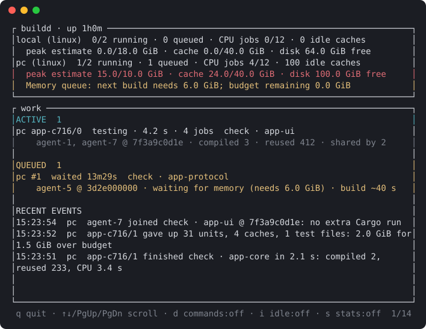

# buildd

One daemon for Cargo builds across Git worktrees, locally or over SSH.

When several worktrees build independently, each keeps its own `target/`
and each Cargo process competes for the machine's cores. buildd gives them
a small pool of warm build slots and one CPU, memory and disk budget per
host. Related worktrees reuse compiled code, identical requests share a
build, and every result names the exact source snapshot it compiled.

## Get started

Requires Git, Rust 1.95+ and macOS or Linux.

```sh
cargo install --path . --root ~/.local
```

With `~/.local/bin` on your `PATH`, run from any Git worktree:

```sh
buildd check -p my-crate               # starts the daemon on first use
buildd test -p my-crate -- some_test   # familiar Cargo arguments
buildd clippy --workspace --all-targets -- -D warnings
buildd plan test --workspace           # preview placement without building
buildd top                             # live builds, queues and resources
buildd failures                        # recent failures and their logs
```

Use `buildd help` for all commands and options. buildd's options go before
Cargo's arguments; buildd manages the target directory and parallelism.
Ctrl-C withdraws your request and stops the build if nobody else needs it.



## How it works

```text
worktree A ─┐                     ┌─ slot 0: checkout + warm target/
worktree B ─┼─ snapshot → daemon ─┼─ slot 1: checkout + warm target/
worktree C ─┘                     └─ SSH → remote daemon
```

1. **Snapshot the source.** A private Git index captures your current files,
   including uncommitted changes, without touching your worktree or staging
   area. The tree ID identifies exactly what will be built.
2. **Combine work.** Identical requests join one build. A newer request from
   the same worktree replaces its older queued request.
3. **Reuse a warm slot.** The scheduler favors slots with less to recompile.
   Each slot owns a fixed checkout path and its own `target/`, so Cargo's
   incremental state stays useful across worktrees and daemon restarts.
4. **Build within the host's budget.** Running builds share compiler job
   tokens. Memory estimates decide what can start; disk pressure evicts old
   artifacts from idle slots. Output streams back with the source tree ID.

Memory reservations use past peaks, not OS limits. By default, an unfamiliar
compilation runs alone to learn its memory needs. Optional branch prewarming
can prepare caches while the host has spare capacity.

## Use other machines

Install buildd and the required toolchains on each host, then add a remote
to the local daemon's `config.toml`:

```toml
[[remote]]
name = "pc"
ssh = "me@pc.example"
os = "linux"
command = "bash -lc 'buildd serve'"
```

```sh
buildd test --os linux --workspace     # choose a Linux host
buildd test --host pc -p my-crate      # choose a specific host
buildd run --host pc --exclusive -- ./benchmark.sh
```

buildd transfers the snapshot with Git over SSH and streams results back.
Each host keeps its own slots and budgets. Without a host or OS constraint,
buildd chooses among enabled hosts using load and cache reuse. Use
`buildd hosts disable local` to send new builds elsewhere.

`--exclusive` waits for existing builds, then runs alone among all work
managed by that host's daemon. `run` executes any command on the same
snapshot a Cargo build would use.

## Configuration and limits

State lives in `$BUILDD_HOME`: by default `~/Library/Caches/buildd` on macOS
or `~/.cache/buildd` on Linux. Set budgets in its `config.toml` with `slots`,
`jobs`, `test_jobs`, `memory_gib` and `disk_gib`. Defaults allow two concurrent
builds per repository and share the available CPUs. Disk admission keeps
15 GiB free plus 10 GiB of growth headroom per running build. See
[the configuration fields](src/config.rs) for all settings and defaults.
Restart daemons after configuration changes or upgrades, once active work
has finished.

- Files ignored by Git are omitted unless already tracked. Generated inputs
  must be tracked or created during the build.
- Builds use the daemon's environment. Pass compiler flags with
  `--rustflags`; the client's environment is not forwarded.
- Build products stay on the machine that built them. Use `--copy-to DIR`
  to export executables after success.
- With `cargo-nextest` installed, `buildd nextest --workspace` can skip
  unchanged test binaries that already passed. Use `--rerun-all` to force
  them to run; use `buildd test --doc` for doctests.
